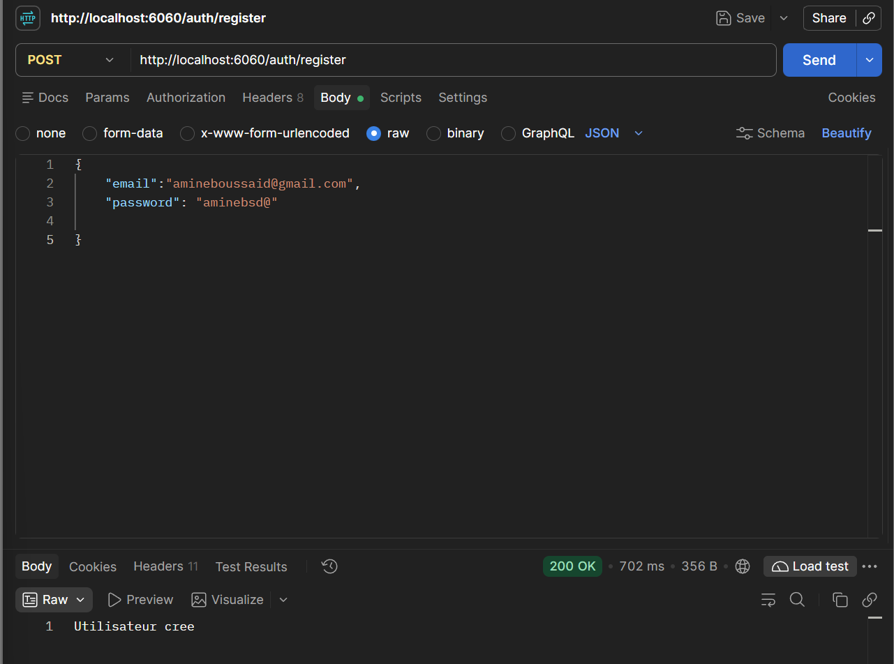
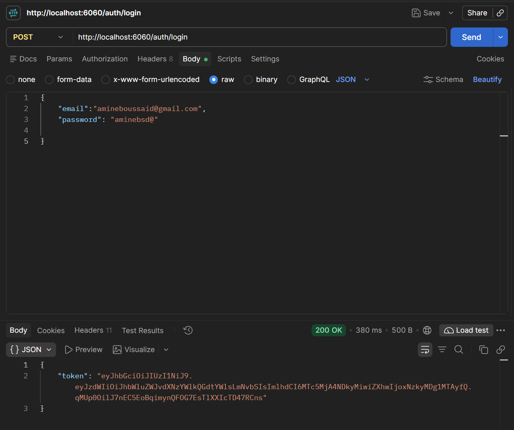
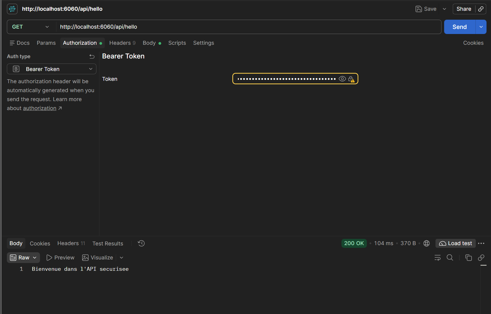
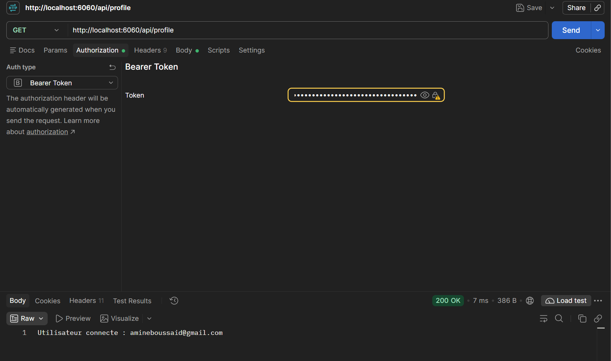

# Spring Security JWT Authentication API

A stateless REST API secured with **Spring Security** and **JSON Web Tokens (JWT)**. Users can register, log in to receive a signed token, and use that token to access protected endpoints.

Package: `ma.enset.security.securityapp`

---

## Features

- User registration with BCrypt-hashed passwords
- Login endpoint that returns a signed JWT
- Stateless authentication (no HTTP session, no CSRF token)
- Custom `JwtFilter` (`OncePerRequestFilter`) that validates the `Bearer` token on every request
- Protected routes under `/api/**`
- H2 in-memory database with console access for local development

---

## Tech Stack

- Java 17+
- Spring Boot 3.x
- Spring Web
- Spring Security 6
- Spring Data JPA
- H2 Database
- JWT (HS256)
- Maven

---

## Project Structure

```
ma.enset.security.securityapp
├── controllers
│   ├── AuthController.java        # /auth/register, /auth/login
│   └── UserController.java        # /api/hello, /api/profile
├── dto
│   ├── RegisterRequest.java       # email, password
│   ├── LoginRequest.java          # email, password
│   └── AuthResponse.java          # token
├── entities
│   └── AppUser.java               # email, password, role
├── repository
│   └── UserRepository.java        # existsByEmail, findByEmail
├── service
│   ├── CustomUserDetailsService.java
│   └── JwtService.java            # generate / validate tokens
└── security
    ├── JwtFilter.java             # reads and validates the Bearer token
    └── SecurityConfig.java        # filter chain, password encoder, auth manager

docs
└── images                         # Postman screenshots used in this README
```

---

## How It Works


1. **Register**: the password is encoded with `BCryptPasswordEncoder` and the user is stored with the role `USER`.
2. **Login**: `AuthenticationManager` checks the credentials, then `JwtService` generates a token whose subject is the user's email.
3. **Access protected routes**: `JwtFilter` runs before `UsernamePasswordAuthenticationFilter`. It extracts the token from the `Authorization` header, loads the user, validates the token, and stores the authentication in the `SecurityContext`.

---

## Getting Started

### Prerequisites

- JDK 17 or newer
- Maven 3.8+

### Run the application

```bash
git clone https://github.com/BoussaidMohamedAmine/jwt-secure-app.git
cd securityapp
mvn spring-boot:run
```

The server starts on **http://localhost:6060**.

### Configuration

Application settings live in `src/main/resources/application.properties`. Typical values for this project:

```properties
server.port=6060

spring.datasource.url=jdbc:h2:mem:securitydb
spring.h2.console.enabled=true
spring.jpa.hibernate.ddl-auto=update
```

> Keep the JWT secret key and expiration time in configuration (or environment variables), not hard-coded in `JwtService`.

---

## API Reference

Base URL: `http://localhost:6060`

| Method | Endpoint         | Auth required | Description                  |
|--------|------------------|---------------|------------------------------|
| POST   | `/auth/register` | No            | Create a new user            |
| POST   | `/auth/login`    | No            | Authenticate and get a JWT   |
| GET    | `/api/hello`     | Yes (Bearer)  | Test the secured API         |
| GET    | `/api/profile`   | Yes (Bearer)  | Get the authenticated user   |

### Register

**Request**

```http
POST /auth/register
Content-Type: application/json

{
  "email": "user@example.com",
  "password": "your-password"
}
```

**Responses**

| Status | Body                  |
|--------|-----------------------|
| 200    | `Utilisateur cree`    |
| 400    | `Email deja utilise`  |

**Postman**



### Login

**Request**

```http
POST /auth/login
Content-Type: application/json

{
  "email": "user@example.com",
  "password": "your-password"
}
```

**Response (200)**

```json
{
  "token": "eyJhbGciOiJIUzI1NiJ9..."
}
```

**Postman**



### Hello (protected)

```http
GET /api/hello
Authorization: Bearer <token>
```

**Response (200)**

```
Bienvenue dans l'API securisee
```

**Postman**



### Profile (protected)

```http
GET /api/profile
Authorization: Bearer <token>
```

**Response (200)**

```
Utilisateur connecte : user@example.com
```

**Postman**



---

## Quick Test with cURL

```bash
# 1. Register
curl -X POST http://localhost:6060/auth/register \
  -H "Content-Type: application/json" \
  -d '{"email":"user@example.com","password":"your-password"}'

# 2. Login and copy the token
curl -X POST http://localhost:6060/auth/login \
  -H "Content-Type: application/json" \
  -d '{"email":"user@example.com","password":"your-password"}'

# 3. Call a protected endpoint
curl http://localhost:6060/api/profile \
  -H "Authorization: Bearer <paste-token-here>"
```

You can run the same requests in Postman: use **Authorization → Bearer Token** for the `/api/**` calls.

---

## Security Configuration

Defined in `SecurityConfig`:

| Setting            | Value                                                        |
|--------------------|--------------------------------------------------------------|
| CSRF               | Disabled (stateless API)                                     |
| Session policy     | `STATELESS`                                                  |
| Public routes      | `/auth/**`, `/h2-console/**`                                 |
| Protected routes   | `/api/**` (authentication required)                          |
| Password encoding  | `BCryptPasswordEncoder`                                      |
| JWT filter         | Added before `UsernamePasswordAuthenticationFilter`          |
| Frame options      | `sameOrigin` (needed for the H2 console)                     |

---
